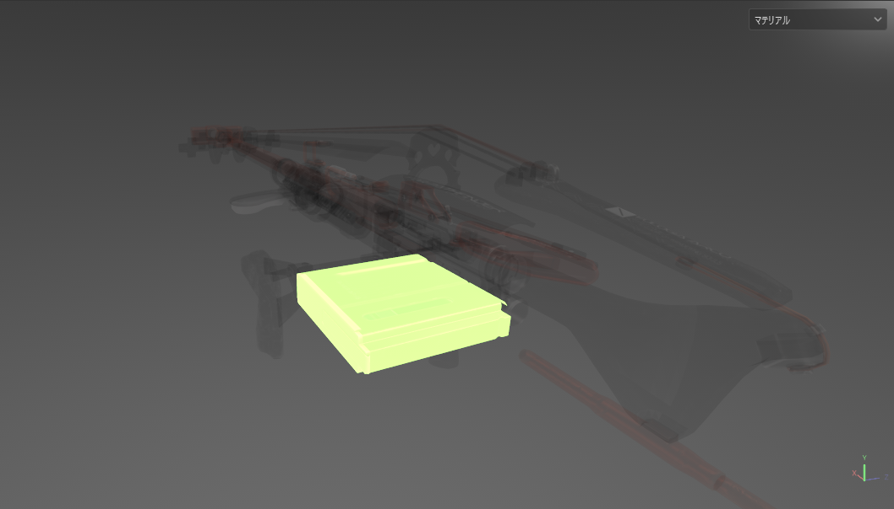
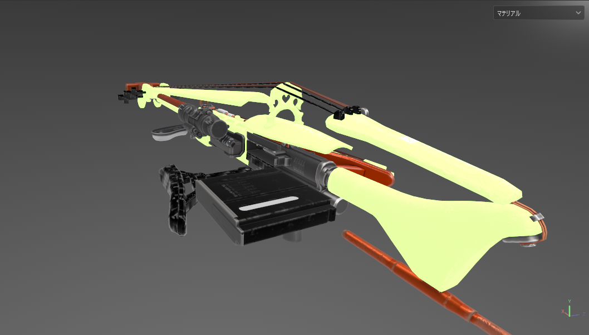
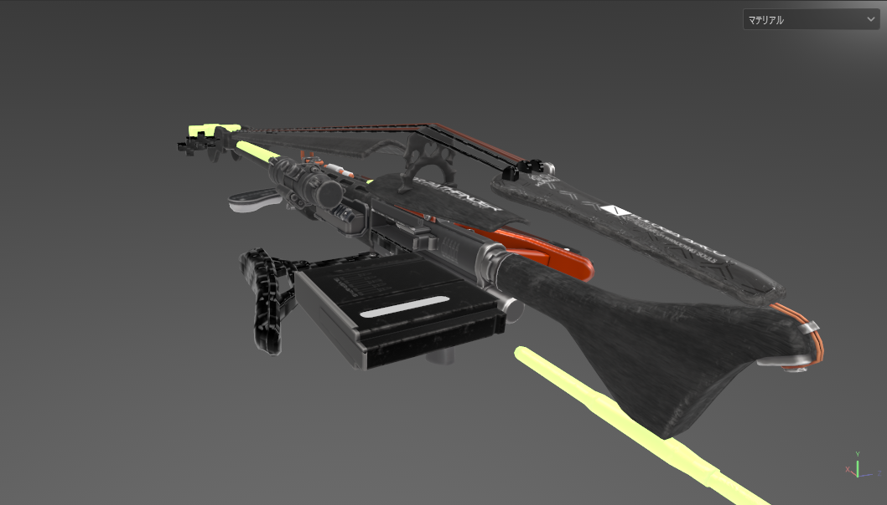
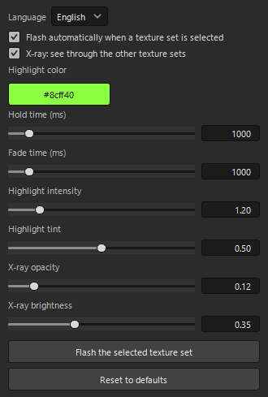
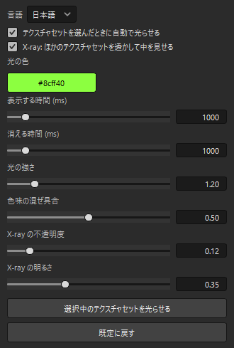

# TexSet Highlight

A small plugin for **Adobe Substance 3D Painter**: select a texture set in the Texture Set List and the
meshes that use it flash in the 3D viewport, then fade out. With X-ray on, everything else turns
semi-transparent during the flash so you can also spot parts hidden inside the model.
Click a layer's mask in the Layers panel and only the masked area flashes, without switching the viewport to the
mask view.

(Model in the screenshots: EUROGIA ARCO, a KURAKU.lab product.)

TexSet Highlight is an independent plugin. It is not affiliated with or endorsed by Adobe.

## Features

- Flash on selection: hold for 1 s, fade out over 1 s (both adjustable)
- Mask flash: select a layer mask (or an effect inside it) and only the masked area flashes, in the normal material view
- X-ray: other texture sets are drawn at 12 % opacity and dimmed while the flash runs (adjustable, can be turned off)
- Works with any number of texture sets; switching 40 sets takes about 0.2 s
- The texture set flash never touches your layer stacks. Shader assignments are restored when the flash ends,
  before every save/close, and on the next open if Painter crashed in the middle of a flash
- Click **Highlight** in the menu bar to open the settings panel: everything in one dockable window
  (auto-flash on/off, mask flash on/off, X-ray, highlight color, hold/fade time, intensity, tint, X-ray opacity/brightness,
  "Flash the selected texture set" (flashes the mask instead when a mask is selected), "Reset to defaults"). Changes apply immediately and persist between sessions.
  The panel is styled to match Painter's own property panels
- UI in English or Japanese (switch in the panel; defaults to Japanese on a Japanese system)

## Install

1. Copy `texset_highlight.py` into Painter's plugins folder (one file; the shader is generated on first use, see below):
   - Windows: `Documents\Adobe\Adobe Substance 3D Painter\python\plugins\`
   - macOS: `~/Documents/Adobe/Adobe Substance 3D Painter/python/plugins/`
2. Start Painter (or Python > Reload Plugins Folder), then enable `texset_highlight` in the Python menu once.
   Painter remembers it (setting `python_plugins/texset_highlight/launch_at_start`) and starts the plugin with
   Painter from then on.
3. **Highlight** appears in the menu bar. Clicking it opens the settings panel, which is a normal Painter dock:
   drag it wherever you like, or reopen it later from the Window menu.

Requirements: Substance 3D Painter 12.x, installed in the standard way (the plugin reads
`resources/starter_assets/shaders/pbr-metal-rough-with-alpha-blending.glsl` next to the Painter executable).
No extra Python packages (uses the PySide6 bundled with Painter).

### Tested with

| | |
|---|---|
| Adobe Substance 3D Painter | **12.1.1** (Vulkan renderer) |
| Painter Python API | 0.3.5 (Python 3.13.9, PySide6 6.8.6) |
| Painter JavaScript API (`alg`) | 1.1.20 |
| OS / GPU | Windows 11 (26200) / NVIDIA GeForce RTX 5060 Ti |
| Project | 40 texture sets at 1024², single shader instance |

Other 12.x releases should work (the plugin only uses `alg.shaders`, `alg.mapexport`, `substance_painter.textureset`,
`substance_painter.layerstack`, `substance_painter.ui` and `substance_painter.event`), but they have not been checked. Painter 11 and older use
PySide2 and are not supported as-is.

## How it works

Painter has no API for drawing overlays in the viewport, so the plugin works through shader instances:

1. It polls the active texture set every 150 ms (there is no selection event in the API).
2. On a change it reads the shader-instance assignment (`alg.shaders.shaderInstancesToObject()`), assigns a
   "TexSet Highlight" instance of the highlight shader to the selected set and, with X-ray on, a
   "TexSet Highlight Ghost" instance to every other set (`shaderInstancesFromObject()`).
3. The highlight shader is Painter's own `pbr-metal-rough-with-alpha-blending.glsl` plus extra parameters:
   `highlight_mix` / `highlight_color` / `highlight_intensity` / `highlight_tint` (emissive flash) and
   `ghost_alpha` / `ghost_dim` (x-ray). The plugin animates them with `alg.shaders.setParameters()`.
   Painter's shader files belong to Adobe, so the plugin does not ship a copy: on first use it reads the stock
   file from your Painter installation, adds the parameters and outputs to a copy in
   `%LOCALAPPDATA%\TexSetHighlight\` (`~/.local/share` equivalent elsewhere), and imports that copy into the
   session. The stock file is never modified. The copy is named after a hash of the stock file and rebuilt
   when the stock shader changes (Painter update); if a future Painter changes the stock shader in a way the
   plugin does not recognise, the highlight turns itself off and says so in the log instead of guessing.
4. When the fade ends the original instances are put back and the temporary instances are removed.
5. Mask flash: when a layer's mask is selected (`layerstack.get_selection_type`), the plugin renders that mask to a
   1024² PNG in UV space and passes it to the shader as `highlight_mask` (`highlight_use_mask` on), so only the
   masked area glows. Painter cannot export a layer mask directly (the `mask` map of `alg.mapexport.save` is the
   material-layering blending mask), so for a moment it adds an anchor point on top of the mask and a hidden fill
   layer that reads the anchor as base color, exports that layer, and deletes both again (about 0.1-0.3 s).

## Limitations

- The flash marks the project as modified (shader assignments are part of the project), even though they are restored.
- A mask flash leaves two entries named "TexSet Highlight: mask (temporary)" in the undo history (adding and
  removing the temporary anchor/layer). Undoing them brings the temporary layer back; just redo or delete it.
- The mask flash shows the layer's own mask, like Painter's mask view (masks of parent folders are not included).
- Image names ending in `_<number>` are read by Painter as UDIM tiles, so the rendered masks are named `mask_u<uid>v<n>m.png`.
- Painter shaders cannot disable the depth test, so the highlighted set is not drawn "on top"; X-ray makes the
  others transparent instead.
- Texture sets that use a custom shader instance are rendered with the stock metal/rough look for the two seconds of the flash.
- The generated shader (and the mask images) live in `%LOCALAPPDATA%\TexSetHighlight\`; deleting that folder is safe.
- Painter removes a shader instance that no texture set uses any more; the plugin keeps a copy of the instance
  definitions and re-creates them on restore.

## License

MIT. Copyright (c) 2026 Kurakurage / KURAKU.lab.

The repository contains only the plugin's own code. The highlight shader is generated on your machine from
the shader file that comes with your copy of Substance 3D Painter and is not part of this repository.
"Adobe" and "Substance 3D Painter" are trademarks of Adobe Inc.

---

## 日本語

テクスチャセットリストでテクスチャセットを選ぶと、そのセットが割り当たっているメッシュが 3D ビューで光って消える
Substance 3D Painter 用プラグインです。「X-ray」をオンにすると、光っている間ほかのセットが透けて暗くなるので、
機体の中に隠れた部品も確認できます。レイヤーのマスクをクリックすると、マスク表示に切り替えなくても、
マスクの部分だけが光ります。

- 選んだとき 1 秒光り、1 秒かけて消える（時間は変えられる）
- マスクのハイライト: レイヤーのマスク（またはマスクの中の効果）を選ぶと、マテリアル表示のままマスクの部分だけが光る
- X-ray: ほかのセットを不透明度 12 %・明るさ 35 % にする（変えられる・切れる）
- テクスチャセットのハイライトはレイヤーを触らない。光り終わったとき・保存や閉じる前・途中で落ちたときの次回起動時に、元のシェーダーの割り当てへ戻す
- メニューバーの「Highlight」をクリックすると設定パネルが開く（Painter のドックなので好きな場所に置ける。閉じたら
  ウィンドウメニューから再表示）。自動で光らせるかどうか、マスクを光らせるかどうか、X-ray、光の色、表示する時間、消える時間、光の強さ、色味の混ぜ具合、
  X-ray の不透明度・明るさ、「選択中のテクスチャセットを光らせる」、「既定に戻す」がすべてこのパネルにある。
  変えた値はその場で反映され、次回起動後も残る。見た目は Painter のプロパティパネルに合わせてある
- パネル右上の「言語」で日本語と English を切り替えられる（日本語の Windows では最初から日本語）

（スクリーンショットのモデルは KURAKU.lab の商品 EUROGIA ARCO です。このプラグインは個人製作で、Adobe とは関係ありません）

### 入れ方
`texset_highlight.py` の 1 ファイルを Painter のプラグインフォルダー
（Windows: `ドキュメント\Adobe\Adobe Substance 3D Painter\python\plugins\`）にコピーして Painter を起動し、
Python メニューで `texset_highlight` を 1 回オンにする。Painter がこれを覚え（設定 `python_plugins/texset_highlight/launch_at_start`）、
次からは起動と同時に有効になる。シェーダーは同梱していない（下の「仕組みと制限」）。

### 動作を確認した環境
- Adobe Substance 3D Painter **12.1.1**（Vulkan）、Python API 0.3.5（Python 3.13.9・PySide6 6.8.6）、JavaScript API 1.1.20
- Windows 11 / NVIDIA GeForce RTX 5060 Ti、テクスチャセット 40 個（1024²）のプロジェクト
- 12.x のほかの版でも動く見込みだが未確認。11 以前（PySide2）はそのままでは動かない

### 仕組みと制限
ビューに色を重ねる API が無いため、選んだセットだけを一時的に発光付きシェーダーのインスタンスに切り替え、
`highlight_mix` を 1 → 0 に動かしてから元に戻しています（JS API `alg.shaders`）。
発光付きシェーダーは、Painter に付属の `pbr-metal-rough-with-alpha-blending.glsl` に発光と透過のパラメーターを足したものです。
Painter のシェーダーファイルは Adobe のものなので、このプラグインには入れていません。初めて光らせるときに、
お使いの Painter のインストール先（実行ファイルの隣の `resources/starter_assets/shaders/`）からそのファイルを読み、
パラメーターを足した写しを `%LOCALAPPDATA%\TexSetHighlight\` に作ってセッションに取り込みます（元のファイルは触りません。
写しは元のファイルが変わると作り直され、将来の Painter で元のファイルの形が変わって足せなくなったときは、
ログにそう書いて光らせるのをやめます。このフォルダーは消しても大丈夫です）。
光るたびにプロジェクトに「未保存」の印が付きます（割り当ては元に戻っています）。Painter のシェーダーは深度テストを
切れないので「手前に描く」ことはできず、代わりに周りを透かしています。独自シェーダーを使うセットは光っている 2 秒だけ
標準の PBR の見え方になります。

マスクのハイライトは、マスクを 1024² の画像（UV 空間）に描き出してシェーダーに渡しています。Painter にはレイヤーのマスクを
直接書き出す API が無い（`alg.mapexport.save` の `mask` は素材レイヤリングのブレンドマスク）ため、一瞬だけマスクの一番上に
アンカーポイントを、一番上に非表示の塗りつぶしレイヤーを置いてアンカーを読ませ、そのレイヤーを書き出してすぐ消します
（0.1〜0.3 秒）。そのため元に戻すの履歴に「TexSet Highlight: mask (temporary)」が 2 件残ります（戻すと一時的な層が
現れるので、やり直すか消してください）。光るのはそのレイヤー自身のマスクで、親のフォルダーのマスクは含みません
（Painter のマスク表示と同じ）。画像の名前の末尾が `_数字` だと Painter が UDIM のタイルとして読むため、
`mask_u<uid>v<n>m.png` という名前にしています。
